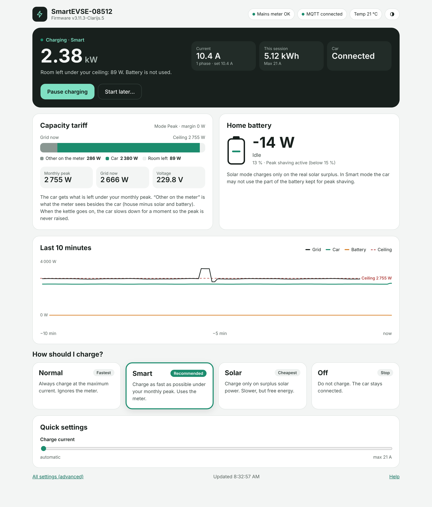
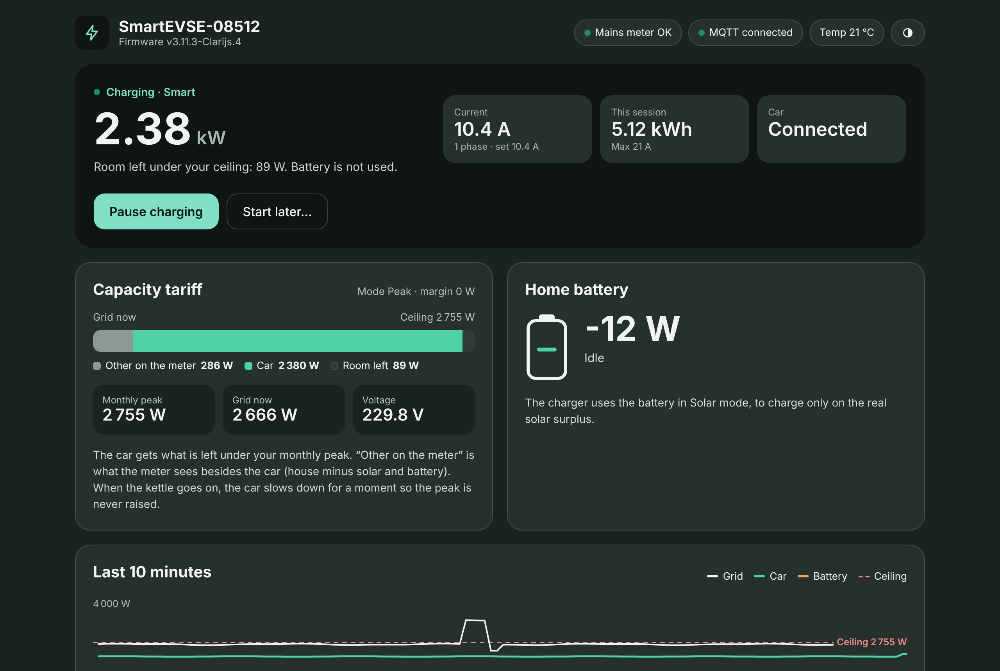
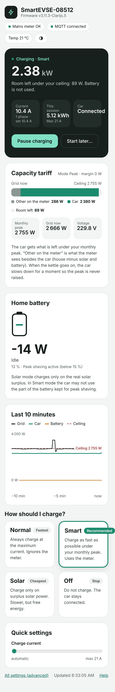
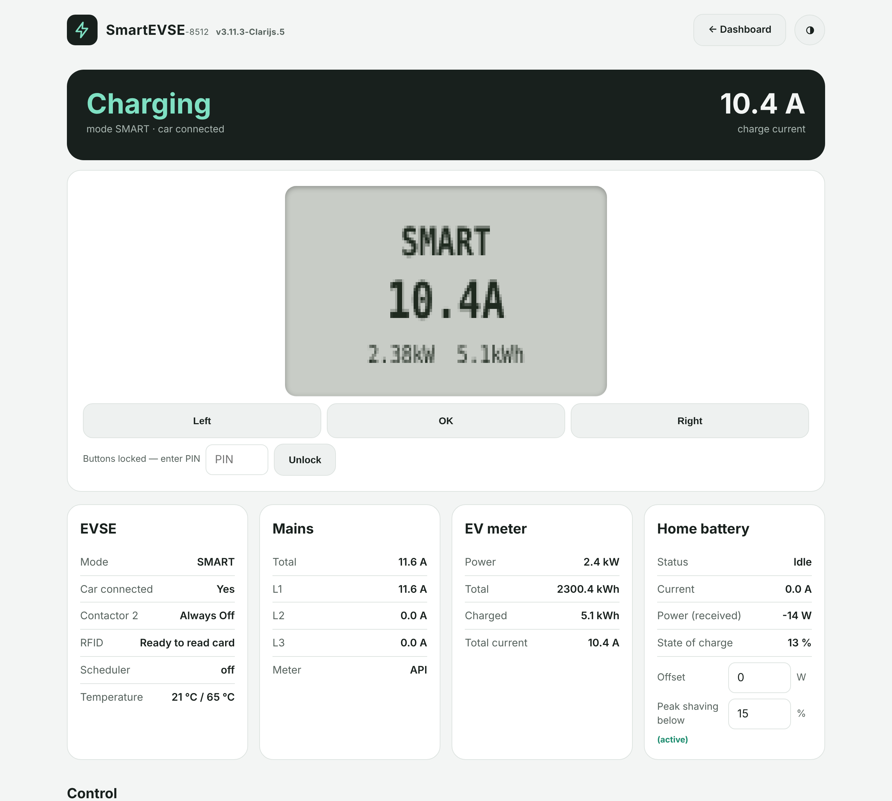
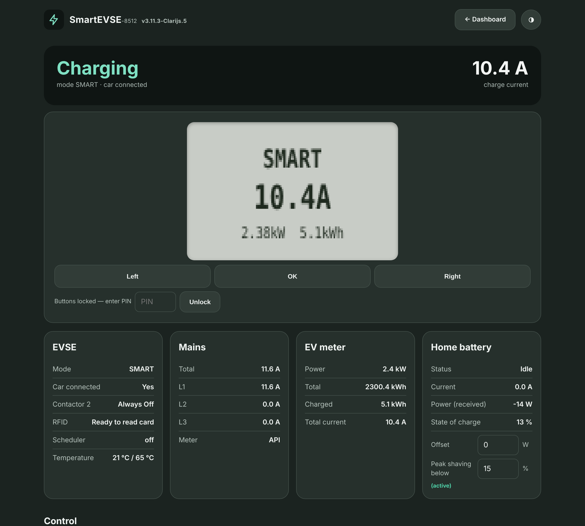

SmartEVSE v3 — Clarijs edition
=========

**SmartEVSE firmware for the Flemish capacity tariff and a home battery.**

This is a fork of [dingo35/SmartEVSE-3.5](https://github.com/dingo35/SmartEVSE-3.5),
the community firmware for the open-source SmartEVSE v3 charge controller. It keeps everything of the
original firmware and adds what is needed to charge an EV **just under your monthly capacity peak**,
with the peak read from your digital meter, **without emptying your home battery into the car**.

> ⚠️ **Unofficial firmware.** Builds from this fork are not signed with dingo35's key. Most of the
> changes are offered upstream as pull requests; see [Status upstream](#status-upstream).

# What it adds

| | Feature | In short |
|---|---|---|
| 🖥️ | **New web interface** | Visual dashboard as start page (status, capacity bar, chart, big mode buttons); every setting under *All settings*; light and dark. |
| ⚡ | **Mode Peak** | Stable ceiling = monthly peak − margin. Never above the peak, not even for a few seconds. |
| 📈 | **Monthly peak from the meter** | The official peak (OBIS 1-0:1.6.0) is synced over MQTT / REST, or read from a HomeWizard P1 (no MQTT needed), and survives a reboot. |
| 🔌 | **Measured voltage** | Power is converted to current with the real mains voltage instead of 230 V. |
| 🎚️ | **0.1 A steps + margin** | Max Sum Mains in 0.1 A steps; configurable margin in W. |
| 🔁 | **Regulation per switched phase** | A single-phase charger corrects an overshoot in one step instead of three. |
| 🔋 | **Home battery in watts** | Send the battery power in W (+ SoC); offset and conversion to amps are done by the charger. |
| 🛡️ | **Peak Shaving SoC** | Below this SoC the battery only does peak shaving: in Smart mode the car cannot use that part of the battery. |
| 🚀 | **Correct start current** | No more start at full current; the setpoint never exceeds the measured headroom. |
| 📡 | **Configurable API timeout** | A short Wi-Fi hiccup of your P1 reader no longer stops charging. |

Measured on a single-phase installation with a 15 kWh home battery: night charging now stays
**92–110 W under the monthly peak** with the home battery idle, where it used to stay 255–455 W under
the peak while the battery delivered ~0.7 kWh into the car.

# New web interface

Open `http://smartevse-<serial>.local/` (or the charger's IP address): the start page is a dashboard
that shows at a glance what the charger is doing and how much room is left under your monthly peak.
Everything else is under **All settings**. Light and dark, on a phone or a computer.

| Dark mode | On a phone |
|---|---|
|  |  |

**All settings** (the former main page, every setting and the remote LCD), in the same style:

| Light | Dark |
|---|---|
|  |  |

*Screenshots with sample data.*

# Pick your path

| You want to… | Start here |
|---|---|
| Understand every change in detail | [**Firmware changes**](CLARIJS-FIRMWARE.md) |
| Set up charging under the Flemish capacity tariff | [**Guide: capacity tariff (Flanders)**](docs/clarijs/guide-capacity-tariff.md) |
| Charge under the capacity tariff **without a home battery** | [**Guide: capacity tariff → CAP STOP**](docs/clarijs/guide-capacity-tariff.md#6-without-a-home-battery-set-cap-stop-short) |
| Combine the charger with a home battery | [**Guide: home battery**](docs/clarijs/guide-home-battery.md) |
| Connect Home Assistant, MQTT or REST | [**Guide: integration**](docs/clarijs/guide-integration.md) |
| Fix a problem | [**Troubleshooting**](docs/clarijs/troubleshooting.md) |
| Install or roll back the firmware | [**Installing**](#installing) |
| See what changed per release (and what is not released yet) | [**Changelog**](CHANGELOG.md) |

# Installing

1. Download the latest `…-dist.zip` from the [**Releases**](https://github.com/Clarijs/SmartEVSE-3.5/releases).
2. Unzip it and open `http://smartevse-<serial>.local/update` (the serial is shown on the LCD).
3. Upload `firmware.bin` (`firmware.debug.bin` is the build with extra logging).

All existing settings are kept. New settings start disabled or at the old default, so the charger
behaves exactly as before until you change them.

**Rolling back:** the firmware is unsigned, so an official signed release of dingo35 cannot be
installed directly over it. Flash an official *unsigned* build first, or flash over USB
(`HowToFlash.txt` in the zip).

# Status upstream

Changes are offered to dingo35 as small pull requests, one subject each:

| Subject | Pull request | Status |
|---|---|---|
| Regulation per switched phase | [#433](https://github.com/dingo35/SmartEVSE-3.5/pull/433) | ✅ merged |
| Monthly peak sync (`Set/CapacityPeakSync`) | [#425](https://github.com/dingo35/SmartEVSE-3.5/pull/425) | in review |
| Max Sum Mains in 0.1 A steps | [#432](https://github.com/dingo35/SmartEVSE-3.5/pull/432) | open |
| Smart mode start current (bug fix) | [#429](https://github.com/dingo35/SmartEVSE-3.5/pull/429) | open |
| Measured mains voltage | [#437](https://github.com/dingo35/SmartEVSE-3.5/pull/437) | open |
| Mode Peak + margin | [#430](https://github.com/dingo35/SmartEVSE-3.5/pull/430) | draft, after #425/#432 |
| Home battery in watts | [#434](https://github.com/dingo35/SmartEVSE-3.5/pull/434) | open |
| ~~Battery Guard~~ | [#439](https://github.com/dingo35/SmartEVSE-3.5/pull/439) | withdrawn (removed from this fork) |
| Flanders: budget over ≥ 2 min | [#436](https://github.com/dingo35/SmartEVSE-3.5/pull/436) | draft |

Names of MQTT topics can still change during review (e.g. `Set/CapacityPeak` in this firmware is
`Set/CapacityPeakSync` in #425).

# Reference documentation

| Area | Document |
|---|---|
| All changes of this fork, MQTT/REST reference | [CLARIJS-FIRMWARE.md](CLARIJS-FIRMWARE.md) |
| LCD menu and settings (original + additions) | [configuration.md](docs/configuration.md) |
| REST API | [REST_API.md](docs/REST_API.md) |
| Hardware installation | [installation.md](docs/installation.md) |
| Operation | [operation.md](docs/operation.md) |
| OCPP | [ocpp.md](docs/ocpp.md) |
| Building and flashing | [building_flashing.md](docs/building_flashing.md) |

# About the SmartEVSE

The SmartEVSE is an open-source EVSE (Electric Vehicle Supply Equipment): 1- and 3-phase charging,
fixed cable or socket, locking actuator, contactor control, RFID, Modbus kWh meters, Sensorbox,
HomeWizard P1, MQTT with Home Assistant discovery, REST API and OCPP 1.6j. Up to eight units can share
one mains connection. Hardware and the original firmware: [SmartEVSE](https://github.com/SmartEVSE/SmartEVSE-3)
and [dingo35/SmartEVSE-3.5](https://github.com/dingo35/SmartEVSE-3.5); all credit for the base
firmware goes to their maintainers and contributors.

# License

Same license as the original firmware: see [LICENSE](LICENSE).
