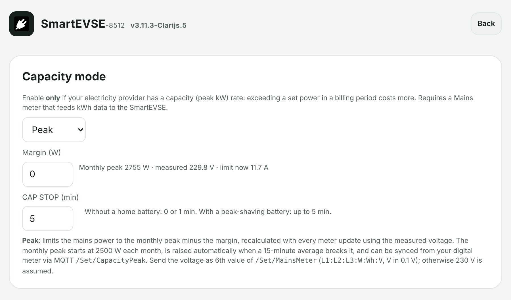

# Guide: charging under the Flemish capacity tariff

[← Back to the overview](../../README.md)

Since 2023 the Flemish grid operator bills the **highest 15-minute average power of the month**
(minimum 2.5 kW). Charging an EV can easily set a new peak. This guide sets up the SmartEVSE so the
car charges as fast as possible **without ever raising that peak**.

## 1. What you need

| | |
|---|---|
| Charger | SmartEVSE v3 with this firmware, mode **Smart** |
| Mains measurement | A reader on the P1 port of the digital meter, sending to the SmartEVSE every second |
| Network | An MQTT broker (e.g. Mosquitto) that both the P1 reader and the SmartEVSE use |

Two ways to get the meter data to the charger:

- **A P1 reader that publishes MQTT** (e.g. an ESP8266 with ESPHome): see [section 3](#3-send-the-measurements-from-the-p1-port).
- **A HomeWizard P1 meter**: no MQTT and no ESP needed, see [section 3b](#3b-or-a-homewizard-p1-meter).

### Which digital meters?

The capacity tariff applies in **Flanders** (Fluvius). All Fluvius digital electricity meters have a
P1 port and report the official monthly peak (OBIS `1-0:1.6.0`):

| Meter | Phases |
|---|---|
| Sagemcom S211 | 1-phase |
| Sagemcom T211 | 3-phase (3×230 V and 3×400 V) |
| Landis+Gyr E360 | 1-phase and 3-phase |
| Sagemcom XT211 (newer generation) | 1-phase and 3-phase |

- **Open the P1 port first:** it is closed by default. Open it on [mijn.fluvius.be](https://mijn.fluvius.be)
  (*Producten & diensten → Verbruik → Beheer poorten*). When the port is open the meter display shows
  a small arrow ▼ above "P1". Use the P1 port (yellow cover), not the S1 port.
- **Landis+Gyr E360 on 3×230 V** reports 0 W per phase; the charger then uses the total power for the
  regulation (handled automatically).
- **Voltage:** if a meter or reader does not report the voltage, the charger keeps using 230 V.
- **Wallonia and Brussels** have no billed monthly peak (yet): the SmartEVSE works there with the same
  readers for load balancing and Solar, but mode Peak does not save anything on the bill.

## 2. How the charger limits the power

```
monthly peak (billed, from the meter)      2755 W
SmartEVSE ceiling = peak − margin           2700 W   (margin 55 W)
EV current = ceiling − rest of the house, converted with the measured voltage
```

**Mode Peak** keeps a stable ceiling just under the monthly peak. Every mains measurement
(every second) the SmartEVSE recalculates how much is left for the car.

> **Why not mode Flanders?** Flanders spreads a 15-minute energy budget. When the house used little at
> the start of a quarter, it allows more than the peak for the rest of the quarter. The average stays
> correct, but the instantaneous power goes above the peak. With a home battery doing peak shaving,
> that extra comes from the battery (measured: −2.2 kW into the car). Peak does not have this problem.
> The difference in charging time is small: about 5–7 minutes on a ~10 kWh night session.

## 3. Send the measurements from the P1 port

The SmartEVSE needs two things over MQTT:

| Topic | Payload | How often |
|---|---|---|
| `<prefix>/Set/MainsMeter` | `L1:L2:L3:W:Wh:V`: current per phase (0.1 A, + = import), power (W), total import (Wh), voltage L1 (0.1 V) | every second |
| `<prefix>/Set/CapacityPeak` | official monthly peak in W (OBIS 1-0:1.6.0), at least 2500 | every minute |

`<prefix>` is `SmartEVSE-<serial>`, e.g. `SmartEVSE-08512`.

ESPHome example (single phase; give the `dsmr` sensors the ids used here):

```yaml
wifi:
  power_save_mode: none        # recommended on an ESP8266: fewer delayed messages

mqtt:
  broker: 192.168.0.129
  username: esphome
  password: !secret mqtt_password
  discovery: false
  topic_prefix: null
  log_topic: null
  birth_message:
  will_message:

interval:
  - interval: 1s
    then:
      - if:
          condition:
            lambda: 'return !isnan(id(p_del).get_raw_state()) && !isnan(id(p_ret).get_raw_state());'
          then:
            - mqtt.publish:
                topic: SmartEVSE-08512/Set/MainsMeter
                payload: !lambda |-
                  float v = id(v_l1).get_raw_state();
                  if (isnan(v) || v < 180 || v > 270) v = 230.0;
                  float w = (id(p_del).get_raw_state() - id(p_ret).get_raw_state()) * 1000.0;
                  int l1 = (int) lroundf(w / v * 10.0);
                  float e1 = id(e_t1).get_raw_state(), e2 = id(e_t2).get_raw_state();
                  long wh = (isnan(e1) || isnan(e2)) ? -1 : lround((e1 + e2) * 1000.0);
                  char buf[64];
                  snprintf(buf, sizeof(buf), "%d:0:0:%d:%ld:%d",
                           l1, (int) lroundf(w), wh, (int) lroundf(v * 10.0));
                  return std::string(buf);
  - interval: 60s
    then:
      - if:
          condition:
            lambda: 'return !isnan(id(piek_maand).get_raw_state());'
          then:
            - mqtt.publish:
                topic: SmartEVSE-08512/Set/CapacityPeak
                payload: !lambda |-
                  int w = (int) lroundf(id(piek_maand).get_raw_state() * 1000.0);
                  return to_string(w < 2500 ? 2500 : w);
```

`get_raw_state()` uses the value of every telegram, also when you throttle the same sensors towards
Home Assistant (e.g. `throttle: 5s`), which keeps the ESP lighter.

## 3b. Or: a HomeWizard P1 meter

With a [HomeWizard Wi-Fi P1 meter](https://www.homewizard.com/) the charger reads the meter itself
over the local API (`http://<p1meter>/api/v1/data`, about every 2 seconds). Nothing to program.

| What the charger reads | HomeWizard API field | Used for |
|---|---|---|
| Current per phase | `active_current_l1_a` … `l3_a` | the regulation (Smart, Solar, Peak) |
| Power | `active_power_w` (and per phase) | import/export direction, 3-phase meters |
| Total import / export | `total_power_import_kwh`, `…_export_kwh` | energy counters |
| Voltage L1 | `active_voltage_l1_v` | watts → amps in the capacity modes (instead of 230 V) |
| **Monthly peak** | `montly_power_peak_w` | the official Fluvius peak, as `Set/CapacityPeak` does over MQTT |

`montly` is spelled like that in the HomeWizard API. The monthly peak is only in the data on a
**Belgian** meter and needs HomeWizard firmware 4.14 or newer; on other meters the field is missing and
the charger keeps its own value.

**Set up:**

1. Turn on the *Local API* in the HomeWizard Energy app (*Settings → Meters → your P1 meter → Local API*).
2. On the SmartEVSE LCD: `MAINS MET` = **Homewizrd**, `MAINS HST` = your P1 meter (found automatically
   via mDNS; *Discover* scans again).
3. `CAP MODE` = **Peak**, `MODE` = **Smart**, see the settings below (skip the MQTT rows).
4. Check `GET /settings`: `capacity_peak_month` should show your meter's peak.

> The HomeWizard path is built after the HomeWizard API documentation and has **not been tested with a
> real HomeWizard yet**. Feedback is welcome (see [troubleshooting](troubleshooting.md)).

## 4. Settings on the SmartEVSE

| Setting | Value | Where |
|---|---|---|
| `MAINS MET` | **API** (P1 reader over MQTT) or **Homewizrd** (HomeWizard P1) | LCD menu |
| `MODE` | **Smart** | LCD, web, MQTT |
| `CAP MODE` | **Peak** | web interface → All settings → Capacity, or LCD |
| Margin | **0–55 W** with the measured voltage (see the battery guide) | All settings → Capacity, `Set/CapacityMargin`, REST `capacity_margin` |
| `CONTACT 2` | **Always Off** for a single-phase installation | LCD menu |
| Mains meter timeout | **20–30 s** for a P1 reader on Wi-Fi (API only) | `Set/MainsMeterTimeout` |
| `CAP STOP` | **without a home battery: Off (0) or 1 min**; with a peak-shaving battery: up to 5 min | LCD menu, All settings → Capacity |

Check `GET /settings`: `capacity_peak_month` should show your meter's peak and `capacity_voltage`
the measured voltage.



## 5. What to expect

- At the start of a month the peak is 2500 W (the minimum). It rises automatically when the meter
  reports a higher quarter.
- The car starts at the current that is actually free, not at full current.
- Night charging settles about 50–110 W under the peak. Short peaks in the house (kettle) are
  corrected within a second or two.

## 6. Without a home battery: set CAP STOP short

`CAP STOP` (Max Sum Mains Time) is how long the charger keeps the car at its minimum current (6 A)
when even 6 A does not fit under the ceiling, before it stops charging. During that time the grid is
**above** your peak. With a peak-shaving home battery the battery covers those minutes; **without a
battery they count fully in the 15-minute average**.

Example, single phase, monthly peak 3000 W, margin 0. The car charges at 2500 W with 450 W in the
house. Then the house goes to 2500 W for 6 minutes (oven + hob):

| | What happens | 15-minute average |
|---|---|---|
| **CAP STOP = 5 min** | car to 6 A (~1380 W), grid ~3880 W for 5 minutes, then stop | **~3230 W: new peak** |
| **CAP STOP = 1 min** | car at 6 A for 1 minute, then stop | ~2860 W |
| **CAP STOP = Off (0)** | stops within a few seconds | ~2770 W |

Charging restarts by itself (after about a minute) as soon as there is room for 6 A again.

| | Advice |
|---|---|
| **No home battery** | `CAP STOP` **Off (0)** (always safe, stops at every peak) or **1 min** (a kettle of 1–2 minutes does not stop charging; a long peak stops it in time). Not more than 2 minutes. |
| **Home battery with peak shaving** | up to 5 minutes is fine: the battery shaves the minutes at 6 A. Keep the [Peak Shaving SoC](guide-home-battery.md#3-keep-the-peak-shaving-part-of-the-battery-out-of-the-car-smart-mode) set so the battery keeps enough for this. |

Next: [combine it with a home battery](guide-home-battery.md) ·
[problems?](troubleshooting.md)
